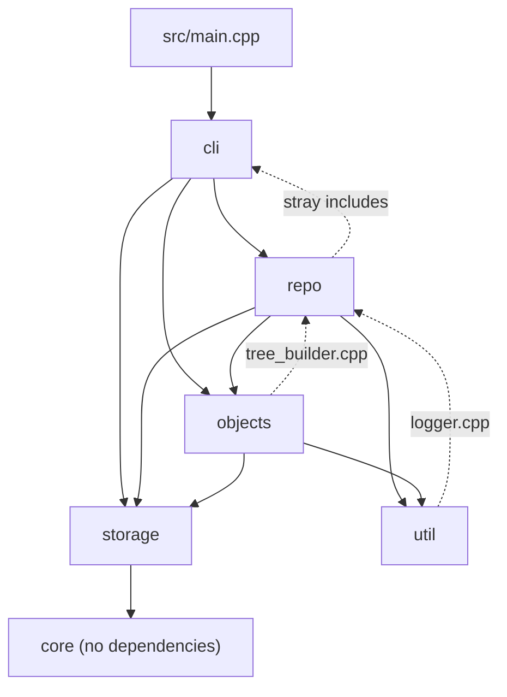
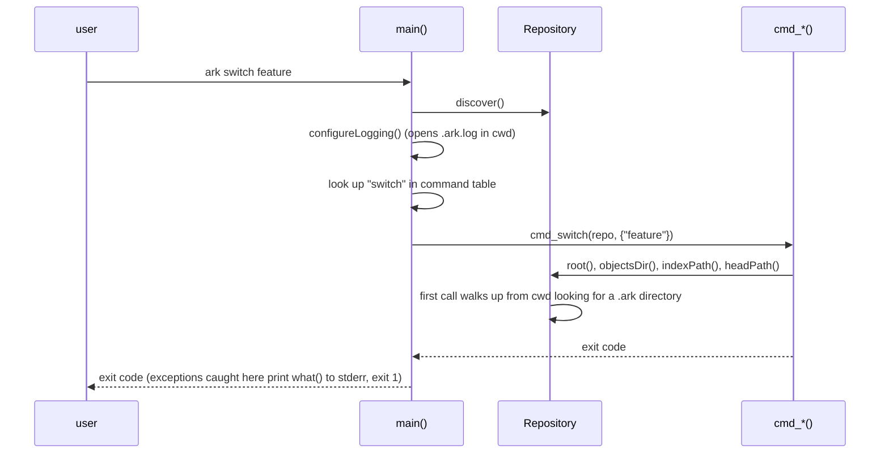
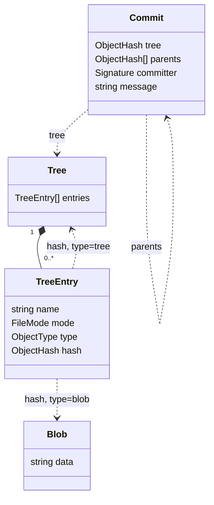
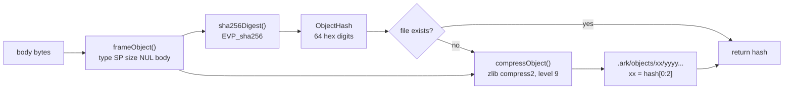
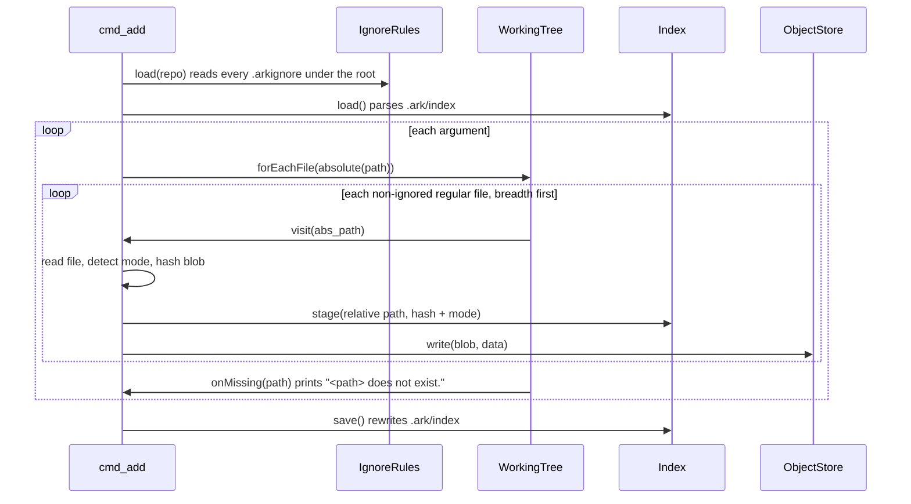
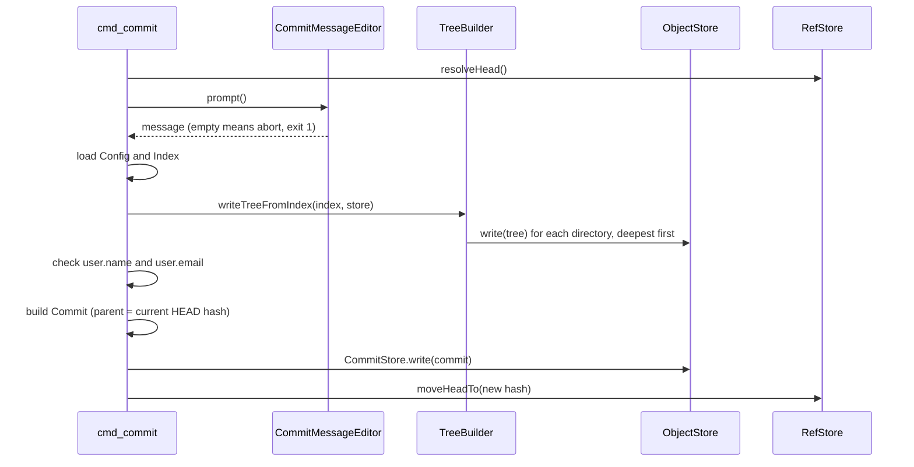
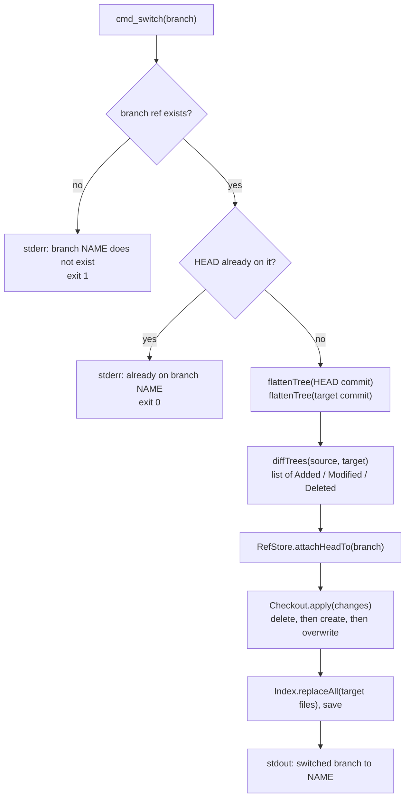
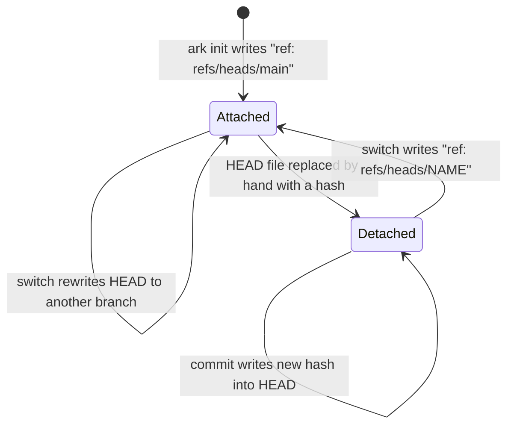

# Ark architecture

This document describes how Ark is put together: the source layers, the object model, how objects and the index are stored on disk, and what each command does step by step. Every claim here was checked against the source; file paths are given so you can check them again. Where the code does something wrong, this document says so and points to the known issues in the [README](README.md#known-issues).

## Source layout

Headers live in `include/ark/<module>/` and implementations in `src/<module>/`. `CMakeLists.txt` builds everything except `main()` into a static library, `ark_core`. The `ark` binary is `src/main.cpp` linked against it, and the test binary `test_ark` links the same library.

| Module | Contents |
|---|---|
| `core` | Value types: `ObjectHash`, `RepoPath`, `BranchName`/`RefName`, `FileMode`, `ObjectType`, exceptions |
| `util` | Logger, string helpers, filesystem helpers, UTC offset |
| `storage` | Object framing, SHA-256 (OpenSSL EVP), zlib, the `ObjectStore` |
| `objects` | `Blob`, `Tree`, `Commit`, `TreeBuilder`, `flattenTree`, `diffTrees`, `CommitStore`, `CommitDAG` |
| `repo` | `Repository`, `Index`, `IndexFile`, `RefStore`, `Config`, `IgnoreRules`, `WorkingTree`, `Checkout`, status |
| `cli` | One function per command (`src/cli/commands/*.cpp`) and the commit message editor |

### Module dependencies

Solid arrows are the intended direction, taken from the `#include <ark/...>` lines. Dotted arrows are includes that point back up the stack. Edges to `core` are left out because every module uses it.



The dotted edges are real and make the layering looser than it looks:

- `src/util/logger.cpp` includes `ark/repo/repository.h`.
- `src/objects/tree_builder.cpp` includes `ark/repo/index.h`, because `writeTreeFromIndex` takes an `Index`.
- `src/repo/ref_store.cpp`, `config.cpp` and `repository.cpp` include `ark/cli/commit_message_editor.h` (and `repository.cpp` includes `ark/cli/commands.h`). Nothing in them uses those headers.

## Entry point and repository discovery

`main()` in `src/main.cpp` calls `Repository::discover()` before it looks at the command name, builds a table of command functions and calls the one you asked for. Every command except `init` takes a `const Repository&`.



`Repository` (`src/repo/repository.cpp`) is cheap to construct. It finds the root lazily on the first `root()` call by walking from the current directory up to `/` until a directory contains `.ark/`. If none is found it throws `NotARepositoryException` ("Not inside an Ark repository"). Every path helper (`objectsDir()`, `indexPath()`, `headPath()`, `refsDir()`, `configPath()`) is `root() + "/.ark/..."`.

Because the lookup is lazy, `ark init` works outside a repository: `cmd_init` ignores the `Repository` argument and uses `./.ark`.

## On-disk layout

```
<repo root>/
├── .ark/
│   ├── HEAD                      "ref: refs/heads/main" or a bare 64-hex hash
│   ├── config                    INI text, see USAGE.md
│   ├── index                     staging area, one line per file
│   ├── objects/
│   │   └── 3f/                   first two hex digits of the hash
│   │       └── 2a9c...e1         remaining 62 digits; zlib-compressed object
│   └── refs/
│       └── heads/
│           └── main              64 hex digits, no newline
├── .ark.log                      log file, written in the current directory (known issue)
└── .arkignore                    optional
```

`ark init` (`src/cli/commands/init.cpp`) creates `objects/`, `refs/heads/`, an empty `index` and an empty `config`. It writes `ref: refs/heads/main` into `HEAD` and 64 zeros into `refs/heads/main`. So `main` exists from the start but points at the zero hash, which means "no commits yet".

## Object model

Three object types. A commit points to one tree and zero or more parent commits. A tree points to blobs and to other trees. Everything is referenced by hash.



Definitions: `include/ark/objects/blob.h`, `tree.h`, `commit.h`. `FileMode` (`include/ark/core/file_mode.h`) has four values with these octal strings:

| `FileMode` | Written as |
|---|---|
| `Regular` | `100644` |
| `Executable` | `100755` |
| `Symlink` | `120000` |
| `Directory` | `040000` |

`Executable` is chosen when the owner execute bit is set (`detectFileMode` in `src/core/file_mode.cpp`).

### Object bodies

These are the exact bytes passed to the framing step. All three are written by the code listed.

**Blob** is the raw file content (`Blob::data`).

**Tree** (`Tree::serialize` in `src/objects/tree.cpp`): one line per entry, sorted by `name` with a plain byte comparison, each ending in `\n`:

```
<mode> <type> <hash> <name>
```

```
100644 blob 96c18f0297e38d01f4b2dacddea4259aea6b2961eb0822bd2c0c3f6029030045 a.txt
040000 tree 923136a58bd5a0ced7fac85de3910d10bbb732837aacbac50ab2f9c1765e7f08 d
```

The name is the rest of the line, so names with spaces survive. Names containing a newline would not.

**Commit** (`Commit::serialize` in `src/objects/commit.cpp`):

```
tree <tree-hash>
parent <parent-hash>
committer <name> <<email>> <unix-time> <utc-offset>
<message>
```

- One `parent` line per parent. A commit made by `ark commit` on a new repository still gets one, with the zero hash (known issue).
- There is no author line.
- There is no blank line between `committer` and the message. The message is written as given, followed by one `\n`. Editors usually leave a trailing newline in the message, so the stored body typically ends with a blank line.
- `Commit::parse` is the inverse and removes one trailing `\n` from the message.

Real example from a two-commit repository (`ark cat-file <hash>`):

```
tree bcfb7e619280683585819565713524b0446f3cdb6ac483e527b6ed32502c2126
parent f57415b3d2e5abc8a0083d15946f4acad9f354e377cffdee7c5872f820b7c1a5
committer Ada <ada@example.com> 1792783664 +0530
first commit

```

## Object storage and the write path

`ObjectStore::write` (`src/storage/object_store.cpp`) is the only place objects are written. Framing is in `src/storage/object_format.cpp`:

```
<type> <body size in bytes>\0<body>
```

`type` is `blob`, `tree` or `commit`; the size is decimal; `\0` is a single NUL byte. The object's id is the SHA-256 of that whole frame, not of the body alone.



Details:

- `sha256Digest` (`src/storage/sha256.cpp`) uses `EVP_DigestInit_ex` / `Update` / `Final_ex` with `EVP_sha256()`. It does not use the deprecated `SHA256()` functions.
- Compression is `compress2` with `Z_BEST_COMPRESSION` (`src/storage/compression.cpp`).
- If the object file already exists, nothing is written. Identical content is stored once.
- If compression fails and returns an empty string, `write` stores the uncompressed frame. `decompressObject` would then fail on it and return an empty string.
- Reads go through `readFramed` (decompress) and `parseObjectFrame`, which checks the header, the type name and that the declared size matches the body, and throws `ObjectFormatException` otherwise. Callers get the body without the header.
- Writes are not atomic. A crash mid-write can leave a partial object file.

## The index

`.ark/index` is a text file. One line per staged file:

```
<mode> <hash> <path>
```

```
100644 96c18f0297e38d01f4b2dacddea4259aea6b2961eb0822bd2c0c3f6029030045 a.txt
100644 14f5162e2fe3d240d0d37aaab0f90e4af9a7cfa79639f3bab005b5bfb4174d9f d/b.txt
```

- `mode` is one of the four octal strings above.
- `hash` is the blob hash (64 hex digits).
- `path` is the rest of the line after the second space, so it may contain spaces. It is repository-relative with `/` separators.
- Lines are sorted by path. In memory the index is a `std::map<RepoPath, FileEntry>` (`FlatTree`, `include/ark/objects/flat_tree.h`), and `IndexFile::write` iterates it in order (`src/repo/index_file.cpp`).
- Empty lines are skipped when reading. A line with fewer than two spaces or an unknown mode throws `IndexCorruptedException` ("Index file is corrupted").
- The index has no header, no checksum and no timestamps. Ark re-hashes files to detect changes.

The index is rewritten in full on every `Index::save()`.

## Commands, step by step

### `ark add`

`src/cli/commands/add.cpp`. Blobs are written to the object store as files are visited; the index file is written once at the end.



A missing path only prints a message to stderr. The command keeps going and still exits 0 (known issue). Nothing checks that the path is inside the repository (known issue), and `.ark/` is not excluded from the walk (known issue).

### `ark commit`

`src/cli/commands/commit.cpp`, with helpers in `src/objects/tree_builder.cpp`, `src/cli/commit_message_editor.cpp` and `src/repo/ref_store.cpp`.



Things worth knowing:

- The editor is `$GIT_EDITOR`, then `$VISUAL`, then `$EDITOR`, then `vi`. It is run through `std::system` with the path of `<tmpdir>/ark_commit_msg.txt` appended. The file is read back and deleted.
- The tree is built before the identity check, so a commit that fails for a missing identity can still leave tree objects behind.
- The parent is whatever `resolveHead()` returned, including the zero hash on a new branch. There is no check for "nothing changed since the parent".
- The missing identity message is printed, but the process then calls `exit(0)`.
- `TreeBuilder` (`src/objects/tree_builder.cpp`) turns the flat index into a tree of nodes keyed by path component in a `std::map`, then writes subtrees first and parents after, so every tree can name its children's hashes.
- `moveHeadTo` writes the new hash into the branch file `HEAD` points at, or into `HEAD` itself when it is detached.

### `ark switch`

`src/cli/commands/switch.cpp`, `src/objects/tree_diff.cpp`, `src/repo/checkout.cpp`.



`flattenTree` (`src/objects/flat_tree.cpp`) walks a tree recursively and returns every blob keyed by full path.

`diffTrees` walks the two sorted maps together. A path only in the source is `Deleted`, only in the target is `Added`, and in both with different hashes is `Modified`. It compares hashes only: it never looks at `mode` or at whether a path changed between file and directory. A mode-only change and a file replaced by a directory are therefore not applied (known issue).

`Checkout::apply` first deletes all `Deleted` paths, then creates all `Added` files, then overwrites all `Modified` files. It prints `deleting file ...`, `creating file ...` or `overwriting file ...` on stdout for each. It does not remove directories that become empty.

HEAD is moved before any file is touched, and nothing checks the working tree or index for uncommitted changes first. Uncommitted edits to a file that differs between branches are overwritten, and staged entries are replaced by the target's (known issue).

### `ark status`

`src/cli/commands/status.cpp`, `src/repo/status.cpp`. It scans the working tree into a `FlatTree`, loads the index, flattens the HEAD commit's tree, and `computeStatus` compares the three:

- staged: in the index, and not in HEAD or with a different hash;
- modified: in the index and the working tree with different hashes, and not already staged;
- untracked: in the working tree, in neither the index nor HEAD.

Deleted files are not reported (known issue).

## References

`src/repo/ref_store.cpp` reads and writes `HEAD` and files under `.ark/refs/`.

- `HEAD` holds either `ref: refs/heads/<branch>` (attached) or a bare commit hash (detached). `RefStore::readHead()` returns a `std::variant<RefName, ObjectHash>`.
- A branch is a file `.ark/refs/heads/<branch>` containing a commit hash.
- `ark branch <name>` creates the file with the current commit's hash. It refuses while HEAD resolves to the zero hash ("please make a commit first").



No command creates a detached HEAD. The code supports one (`moveHeadTo`, `isHeadDetached`, `switch` out of it), but you only get there by editing `.ark/HEAD`. `ark log` refuses to run in that state (known issue).

`ark log` (`src/cli/commands/log.cpp`) takes the current branch's commit and calls `CommitDAG::historyFrom` (`src/objects/commit_dag.cpp`). That is a breadth-first walk over parents with no visited set, which is why a commit reachable by two paths is printed twice. The walk stops at the zero hash.

## Design decisions

**Content addressing.** An object's name is the hash of its framed content (`ObjectStore::write`). Two identical files, or two identical trees, are stored once. A tree hash covers every file below it, and a commit hash covers its tree and parents, so one hash identifies a whole snapshot and its history. Hashing the frame (type and size included) means a blob and a tree with the same body get different ids.

**Sorted entries.** `Tree::serialize` sorts entries by name, and the index is a `std::map` keyed by path. The same set of files therefore always produces the same bytes and the same tree hash, whatever order they were staged in. `TreeBuilder` also builds on `std::map`. This was an earlier bug (tree hashes depended on staging order) and is covered by `ObjectsTest.TreeHashDoesNotDependOnStagingOrder`.

**Text index.** `.ark/index` is human-readable, parseable in a few lines (`src/repo/index_file.cpp`), and easy to inspect with `cat`. The cost is speed and size, and paths with newlines cannot be stored. Ark re-hashes files instead of trusting cached timestamps, so there is nothing to get out of sync.

**Strong types.** `ObjectHash`, `RepoPath`, `BranchName` and `RefName` (`include/ark/core/`) wrap strings so a hash cannot be passed where a path is expected. `RepoPath::fromRelative` normalises (`.`, `//`, `..`), `ObjectHash` knows its fan-out directory and file name, and `BranchName::parse` and `RefName::parse` implement the naming rules. The commands mostly call `unchecked(...)` constructors instead of `parse(...)`, so the validation exists but is not applied at the command line (known issue).

**Repository injection.** Commands, `Index`, `Config` and `RefStore` take a `const Repository&` instead of reading the current directory themselves. Path logic lives in one class, and tests can point everything at a temporary directory (the fixtures in `tests/unit/` construct a `Repository` and pass it in).

## Known limitations

The list of open problems is in the [README](README.md#known-issues). It is not repeated here. Each failing test in the suite corresponds to one of them; [tests/README.md](tests/README.md) has the map.
